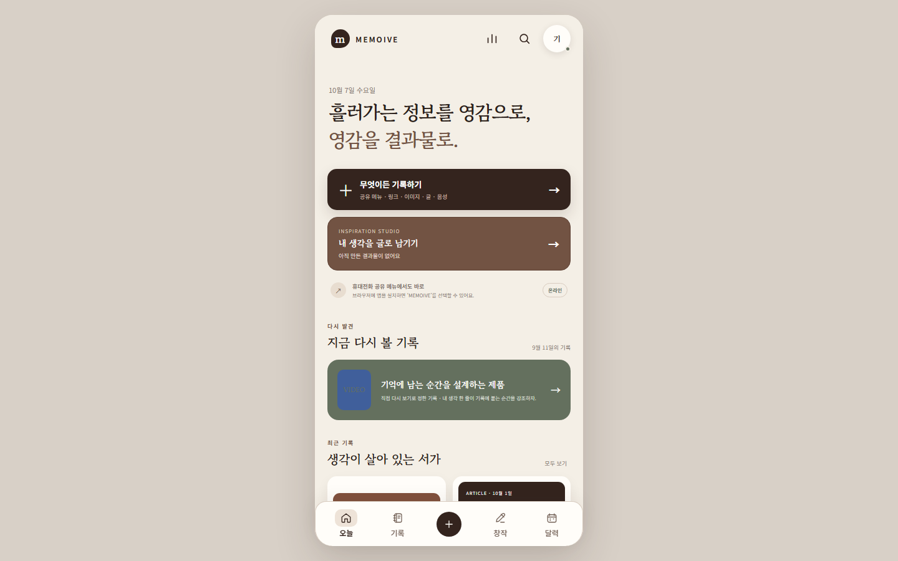

# MEMOIVE

저장한 자료에 남긴 **내 생각이 시간이 지나 다시 나에게 돌아오고**, 쌓인 생각이 원칙과 글로 이어지게 하는 개인 기록 서비스입니다.

[서비스 사용하기](https://memoive.vercel.app/) | [제품 기획서 v2.0](docs/PRD_MEMOIVE_2026-10-14-v2.0.md) | [이전 기획서 v1.3](docs/PRD_MEMOIVE_2026-10-06-v01.md) | [검증 기록](docs/verification.md) | [문서 안내](docs/README-DETAILS.md)

## 30초 요약

| 항목 | 내용 |
|---|---|
| 문제 | 자료를 저장해도 **다시 보지 않는다.** 그래서 생각이 쌓이지 않고 글·기획으로도 이어지지 않는다. |
| 대상 | 제품 사례를 모아 기획안·포트폴리오를 쓰는 서비스 기획·PM 직무 준비자. 관점 커스터마이징으로 직무 밖 관심사까지 확장 |
| 핵심 루프 | 저장 → AI 질문으로 생각 끌어내기 → 다시 돌아오기(리마인드·회고) → 원칙·글로 쓰기 |
| 북극성 지표 | **다시 돌아와 생각을 덧붙인 기록 비율** (v1의 "결과물 전환 비율"에서 변경) |
| 현재 상태 | v2.0 기능 구현과 자동 검사 완료. 외부 사용자의 실제 사용 효과는 아직 측정 전 |



## 기획 과정: v1 → 외부 피드백 → v2

### 1. v1의 가설
"저장할 때 내 생각을 남기면 나중에 찾아 결과물에 활용할 수 있다"는 가설로 `기록 → 내 생각 → 다시 찾기 → 글쓰기` 흐름을 만들었습니다. 성공 기준은 **결과물 전환 비율**이었습니다.

### 2. 외부 피드백 16건을 묶어 읽기
서비스 시연 뒤 참여자 16명이 남긴 서면 의견을 묶음별로 분류했습니다. 직접 사용한 뒤의 평가가 아니라 **시연을 본 첫 반응**이므로 수요나 효과의 증거로 쓰지 않고, 문제 공감과 기대를 확인하는 정성 자료로만 사용했습니다.

| 묶음 | 인원 | 판단 |
|---|---|---|
| 저장만 하고 다시 안 본다 | 5 | 가장 강한 공감 → **북극성 지표를 이 문제에 맞춤** |
| 관점을 직접 만들고 싶다, 관점별 템플릿 | 4 | P1: 관점 커스터마이징 + 템플릿 |
| AI가 질문해서 생각을 구체화, 쓴 뒤 피드백 | 3 | P1: AI의 역할을 생성에서 질문·피드백으로 전환 |
| 기록 이후 무엇을 하나 (분석, 원칙 만들기) | 3 | P2: 월간 회고, 나의 원칙 |
| 연관 기록을 왜 추천하는지 모르겠다 | 1 | P1: 비용은 작고 신뢰에 직결 → 가장 먼저 |
| 리마인드, 모바일 기록, 영상 요약 | 5 | **이미 있던 기능** → 기능 추가가 아니라 발견성 문제로 재정의 |
| 관심 콘텐츠 추천 | 1 | 보류: "내 생각" 중심 차별점을 흐리고 비용이 큼 |

### 3. 문제와 지표를 다시 정의
| | v1.3 | v2.0 |
|---|---|---|
| 한 줄 정의 | 흘러가는 정보를 영감으로, 영감을 결과물로 | 쌓아 둔 기록이 나에게 다시 돌아오는 서비스 |
| 문제의 초점 | 저장 이유를 잊어 결과물에 쓰기 어렵다 | 저장 이후 다시 보지 않는다 |
| AI의 역할 | 요약·해석, 초안 표현 제안 | 요약·해석 + **질문하고, 쓴 글에 의견을 주는 AI** |
| 북극성 지표 | 결과물 전환 비율 | 다시 돌아와 생각을 덧붙인 기록 비율 |

결과물은 기록이 다시 돌아온 **뒤에** 생깁니다. 사람들이 공감한 고통은 그보다 앞 단계였기 때문에, 성공 기준을 앞으로 당겼습니다.

### 4. 우선순위
| 순위 | 항목 | 근거 | 비용 |
|---|---|---|---|
| P1 ① | 연관 기록 추천 이유 구체화 | 신뢰 | 작음 |
| P1 ② | 관점 커스터마이징 + 관점별 템플릿 | 요청 4건, 차별점 강화 | 중간 |
| P1 ③ | AI 질문으로 생각 끌어내기, 쓴 글 피드백 | 북극성 지표의 선행 행동 | 중간 |
| P1 공통 | 기존 기능 발견성 개선 | 요청 5건이 이미 있는 기능 | 작음 |
| P2 ⑥ | 예전 생각을 다시 보여주고 오늘의 생각 덧붙이기 | 북극성 지표에 직접 기여 | 중간 |
| P2 ⑤ | 나의 원칙 (기록 2개 이상을 근거로 한 문장) | "기록 이후 무엇을 하나"에 대한 답 | 중간 |
| P2 ④ | 월간 회고 | 무엇에 치우쳤는지 보기 | 중간 |

## v2.0에서 만든 것

| 기능 | 해결하려는 문제 | 가설 | 측정 이벤트 |
|---|---|---|---|
| 추천 이유 (겹친 생각·주제·단어와 내 생각 인용) | 왜 추천됐는지 모름 | 이유가 구체적이면 연관 기록을 더 연다 | `record_opened` (추천에서 열었는지는 아직 구분하지 않음) |
| 사용 안내 (리마인드·모바일 저장·영상 요약) | 있는 기능을 모름 | 필요한 순간에 알려주면 사용한다 | `hint_shown`, `hint_accepted` |
| 내 관점과 관점별 템플릿, 관점별 생각 비교 | 정해진 관점 4개가 내 상황과 다름 | 내 관점이면 생각을 더 길게 남긴다 | `perspective_created`, `thought_saved` |
| 질문 받기 (최대 3개, AI 또는 기본 질문) | 무엇을 써야 할지 모름 | 질문에 답하는 것만으로 다시 쓸 생각이 남는다 | `question_shown`, `question_answered` |
| 쓴 글 피드백 (주장·근거·출처 구분·반론) | AI가 대신 쓴 글은 내 글이 아님 | 의견만 받으면 내 글을 지키며 고친다 | `writing_feedback_received` |
| ○개월 전 오늘의 생각 + 오늘의 생각 덧붙이기 | 저장한 뒤 다시 안 봄 | 다시 보여주면 생각이 쌓인다 | `memory_shown`, `thought_followup` |
| 나의 원칙 | 기록 이후 쓸 곳이 없음 | 반복된 생각을 원칙으로 묶으면 다시 쓴다 | `principle_created` |
| 월간 회고 (분포·편중 안내·선택형 AI 요약) | 무엇을 모았는지 모름 | 치우침을 보면 다른 관점도 기록한다 | `reflection_received` |

## 판단 기준

- **생각은 사람이 쓴다.** AI는 질문하고 의견을 줄 뿐, AI가 만든 문장은 "내 생각"으로 저장되지 않습니다. 원칙 문장도 사용자가 씁니다.
- **보내기 전에 보여준다.** AI 요청마다 보낼 내용을 미리 보여주고 동의를 받습니다. 기록이나 관점이 바뀌면 동의가 풀립니다.
- **AI가 없어도 끝까지 간다.** AI 연결이 없거나 실패하면 기본 질문과 기기 안 계산으로 같은 흐름을 마칠 수 있습니다.
- **쌓인 기록을 깨지 않는다.** 생각 데이터 구조를 바꾸면서도 기존 기록, 백업, 이전 버전 앱이 그대로 동작하도록 했습니다.
- **근거의 수준을 섞지 않는다.** 합성 자료로 확인한 동작, 시연 반응, 실제 사용 효과를 구분해서 적습니다.

## 확인한 것과 아직 모르는 것

**확인한 것.** 저장 실패, 백업 복원, 동시 수정, 검색, 출처 보존, 관점별 생각의 호환, 질문·피드백·회고 요청의 입력 검사와 실패 처리를 합성 자료로 자동 검사합니다(`npm test`, 실제 Gemini 호출 없음). 375px 화면에서 각 기능의 흐름을 가짜 AI 응답으로 확인했습니다. 단계별 확인 범위는 [기획서 10장](docs/PRD_MEMOIVE_2026-10-14-v2.0.md)에 있습니다.

**아직 모르는 것.**
- 외부 사용자의 실제 사용 효과(북극성 지표 변화, 질문 응답률, 원칙 생성 수)
- 실제 Gemini가 만든 질문·피드백·회고 요약의 품질
- 실제 휴대폰에서의 설치·공유 저장 동작

**다음 검증.** 같은 과제를 기능 변경 전후로 수행해 비교하고, 피드백 참여자 중 희망자 3~5명에게 설명 없이 과제를 맡깁니다. 참여자 수와 조건을 그대로 공개하고 결과를 일반화하지 않습니다. 과제, 모집 메시지, 기록표, 지표 계산법은 [사용 검증 준비물](docs/validation-kit-2026-10-14.md)에 있고, 앱의 `내 사용 테스트`에 v2 과제 5개를 추가했습니다.

## 직접 실행하기

Python이 설치된 환경에서 저장소 최상위 폴더의 터미널에 입력합니다.

```sh
python -m http.server 4182 --directory .
```

브라우저에서 http://127.0.0.1:4182/ 를 엽니다. 정적 화면은 인증값 없이 열리지만, 운영 AI 서버의 허용 주소 설정에 따라 로컬 AI 요청은 거절될 수 있습니다. AI 요청이 거절되어도 기본 질문과 기기 안 계산으로 모든 흐름을 확인할 수 있습니다.

자동 검사는 Node.js 24 이상에서 실행합니다.

```sh
npm ci
npx playwright install chromium
npm test
```

AI 서버(`cloudflare-worker`)를 바꾼 경우 화면보다 먼저 배포해야 합니다. 배포 후 `/health`의 `coaching` 항목에서 `question`, `feedback`, `reflection` 경로를 확인합니다.

## 문서와 코드 안내

| 목적 | 위치 |
|---|---|
| 문제 재정의, 피드백 분석, 요구사항, 단계별 구현 기록 | [제품 기획서 v2.0](docs/PRD_MEMOIVE_2026-10-14-v2.0.md) |
| 이전 범위와 AI 동의·저장 기준 | [제품 기획서 v1.3](docs/PRD_MEMOIVE_2026-10-06-v01.md), [기획 근거](docs/planning-evidence-2026-10-06-v01.md) |
| 확인한 동작과 다음 실험 | [검증 기록](docs/verification.md), [사용자 검증 계획](docs/self-study-plan.md) |
| 저장과 AI 연결 구조 | [구현 설명](docs/implementation-notes-2026-10-07.md) |
| 추천 이유, 관점, 질문, 회고 계산 | [data-tools.js](frontend/js/data-tools.js), [perspective-tools.js](frontend/js/perspective-tools.js), [reflection-tools.js](frontend/js/reflection-tools.js) |
| 화면 모듈 | [frontend](frontend/) |
| AI 서버 (요약, 질문, 피드백, 회고) | [cloudflare-worker](cloudflare-worker/) |
| 자동 검사 | [tests](tests/), [scripts](scripts/) |

## 제작 방식

제작자가 문제 정의, 피드백 해석, 지표와 우선순위, 각 단계의 판단을 정했습니다. 코드 작성과 기술 검사는 AI 코딩 도구(Codex, Claude Code)가 보조했습니다. 공개 저장소에는 시연 자료만 포함하며, 개인 기록, 피드백 참여자 정보, 외부 서비스 인증값은 올리지 않습니다.
