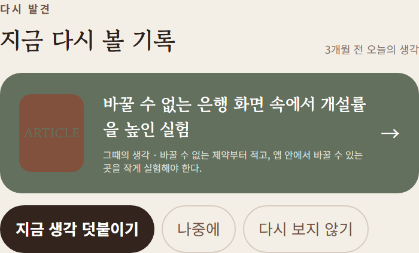
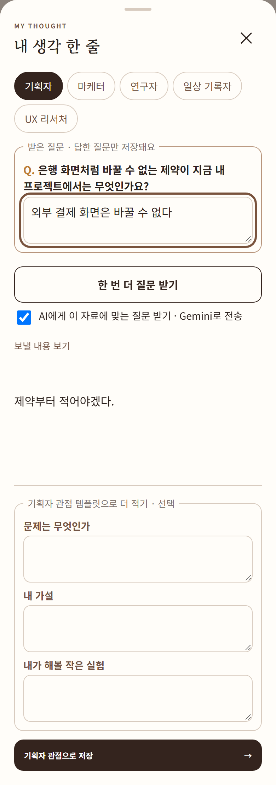
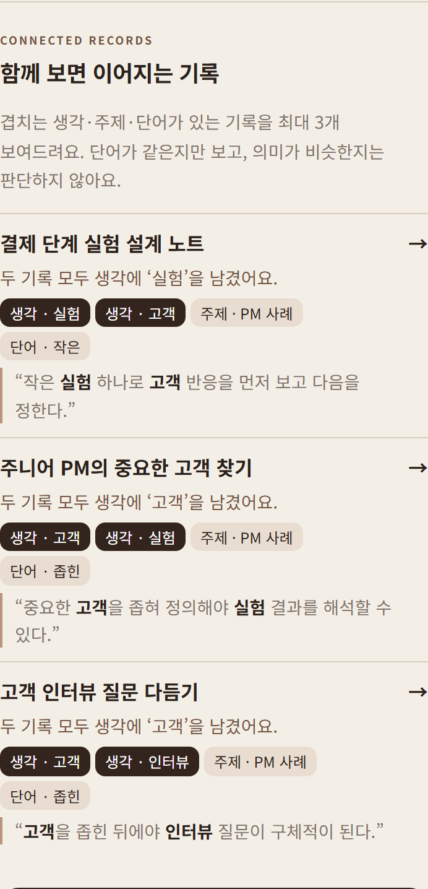

# 대표 사례: 저장한 기록을 다시 쓰게 만들기까지

[서비스 소개](../README.md) | [제품 기획서 v2.0](PRD_MEMOIVE_2026-10-14-v2.0.md) | [사용 검증 준비물](validation-kit-2026-10-14.md)

## 문제 정의

처음에는 저장한 자료를 글과 기획 결과물로 옮기기 어렵다는 문제에서 시작했습니다. 그런데 v1 시연을 본 **16명**의 서면 의견을 분류하니, 결과물을 만드는 단계보다 그 앞의 **저장해 놓고 다시 보지 않는 순간**에 공감이 모였습니다. 이 의견은 시연을 본 반응이며 실제 사용자의 유지율이나 서비스 효과를 보여 주는 자료는 아닙니다.

## 제가 바꾼 판단

| 확인한 의견 | 제가 내린 판단 | v2.0에서 바꾼 것 |
|---|---|---|
| 저장만 하고 다시 안 본다는 공감 **5명** | 글을 쓰기 전에 기록으로 돌아오는 행동부터 만들어야 합니다. | 성공 기준을 `결과물 전환 비율`에서 **다시 돌아와 생각을 덧붙인 기록 비율**로 바꿨습니다. |
| 관점을 직접 만들고 싶다는 의견 **4명** | 정해진 분류만으로는 기록할 이유가 약합니다. | 관점 직접 만들기와 관점별 질문 틀을 추가했습니다. |
| 질문을 받아 생각을 구체화하고 싶다는 의견 **3명** | AI가 문장을 대신 쓰기보다 생각을 끌어내는 편이 문제에 맞습니다. | 질문과 글 피드백으로 AI의 역할을 조정했습니다. |
| 연관 기록을 추천한 이유가 보이지 않는다는 의견 **1명** | 이유를 설명할 수 없으면 다시 꺼낸 기록을 신뢰하기 어렵습니다. | 연관 기록에 겹친 생각, 주제와 단어를 표시했습니다. |

의견 묶음은 서로 겹칠 수 있어 인원 수를 더해 참여자 수로 쓰지 않았습니다. 기능을 추가하기 전에 문제와 지표를 옮긴 결정이 이 사례의 중심입니다. 분류 원본과 우선순위는 [README의 기획 과정](../README.md)에 있습니다.

## 화면에서 볼 수 있는 변화

| 다시 돌아오기 | 생각 남기기 | 연결 이유 확인 |
|---|---|---|
|  |  |  |

v2.0은 예전 생각을 다시 보여 주고, 그 기록에 새 생각을 남기며, 왜 다른 기록과 연결됐는지 확인하는 흐름으로 만들었습니다. 화면은 시연용 합성 데이터와 가짜 AI 응답으로 촬영했습니다. 실제 사용자 기록이 아닙니다.

## 결과 검토

**확인한 것:** v2.0 서비스가 운영 중이고, 합성 자료로 저장, 검색, 출처 보존, 질문과 회고 경로를 검사했습니다. 375px 화면에서 주요 흐름을 확인했고, 배포 후에는 합성 자료로 실제 AI 응답 경로를 점검했습니다. 세부 조건은 [기술 검증 기록](verification.md)과 [README의 확인 범위](../README.md#확인한-것과-아직-모르는-것)에 있습니다.

**사용 제한:** 시연 의견 16건은 직접 사용 경험이 아닙니다. 합성 자료와 AI 대리 점검으로 기능 동작을 확인했지만 외부 사용자의 재방문, 생각 추가 비율, 글 작성 효과는 아직 측정하지 않았습니다. 따라서 지표를 바꾼 것은 **기획 판단**이고 개선 효과는 미검증입니다.

**앞으로 추진:** [사용 검증 준비물](validation-kit-2026-10-14.md)의 동일 과제를 제작자가 먼저 반복 수행해 막힌 지점을 기록합니다. 이어서 희망하는 외부 참여자에게 설명 없이 기록 저장과 재방문 과제를 맡깁니다. 과제 완료 여부, 돌아온 기록에 생각을 덧붙였는지, 도움을 요청한 지점을 확인한 뒤 다음 수정의 우선순위를 정합니다. 이 결과가 나오기 전에는 사용 효과를 주장하지 않습니다.
